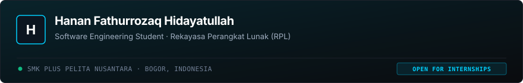

<picture>
  <source media="(prefers-color-scheme: dark)" srcset="assets/header-dark.svg">
  <source media="(prefers-color-scheme: light)" srcset="assets/header-light.svg">
  
</picture>

# Hanan Fathurrozaq Hidayatullah

Software engineering student at **SMK Plus Pelita Nusantara** in Bogor, Indonesia. I build web applications, systems tools, and software prototypes with an emphasis on clean architecture, programming logic, and practical usability.

**Status:** Software Engineering Student (RPL) · Open to technical collaboration, projects, and internship opportunities.

---

### About Me

I study Software Engineering (*Rekayasa Perangkat Lunak / RPL*) at SMK Plus Pelita Nusantara. My work centers on understanding foundational computer science principles and applying them to practical software development:

- **Web Application Engineering:** Designing responsive user interfaces, modular components, and connecting frontend clients to robust server-side APIs.
- **Programming Logic & Data Structures:** Working with Object-Oriented Programming (OOP), algorithmic evaluation, and relational database normalization.
- **Engineering Discipline:** Maintaining clean version control with Git, writing organized technical documentation, and following maintainable code conventions.

---

### Featured Repositories

| Repository | Focus & Description | Primary Stack |
| :--- | :--- | :--- |
| [**portofolio**](https://github.com/Hanan-FH/portofolio) | Production personal developer portfolio built with a modular component architecture, accessible keyboard navigation, and an editorial design system. | React 19, TypeScript, Vite, CSS |
| [**game-shop**](https://github.com/Hanan-FH/game-shop) | 2D store simulation game built in Godot Engine featuring inventory shelf interactions, daily cycle mechanics, and character navigation. | Godot Engine 4, GDScript |

#### Academic & Coursework Projects
- **SIPANDU (School Incident & Complaint Portal):** Full-stack web application featuring complete ticket lifecycle management (CRUD), category tracking, automated urgency classification, and administrative reporting *(PHP, MySQL, Tailwind CSS, JavaScript)*.
- **Simple Calculator:** Desktop GUI application for arithmetic calculation, memory clearing functions, and expression evaluation *(Python, Tkinter)*.

---

### Verified Technical Toolkit

Technologies actively studied in coursework or implemented in working codebases:

| Domain | Technologies |
| :--- | :--- |
| **Languages** | TypeScript, JavaScript, Python, PHP, Java, C / C++, GDScript, SQL, HTML5, CSS3 |
| **Frontend** | React, Tailwind CSS, Semantic HTML, CSS3, Vite |
| **Backend & APIs** | Node.js, Express, PHP, RESTful APIs, OOP Architecture |
| **Databases** | MySQL, PostgreSQL, SQLite, Database Normalization |
| **Tools & Workflow** | Git, GitHub, VS Code, Postman, Linux / Bash, npm |

---

### Current Learning Direction

- Deepening TypeScript static typing and full-stack web application architecture.
- Designing normalized database schemas and optimizing relational SQL queries.
- Building accessible, responsive web interfaces compliant with modern WCAG standards.

---

### Connect

- **Email:** [hananfh77@gmail.com](mailto:hananfh77@gmail.com)
- **LinkedIn:** [Hanan Fathurrozaq](https://www.linkedin.com/in/hanan-fathurrozaq-3a643b427)
- **GitHub:** [@Hanan-FH](https://github.com/Hanan-FH)
- **Portfolio Repository:** [Hanan-FH/portofolio](https://github.com/Hanan-FH/portofolio)
