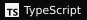
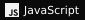
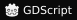
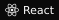
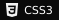
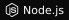
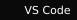

### 01 — About

I am a vocational software engineering student focused on computer science fundamentals and practical application development. I engineer clean user interfaces, structure backend logic, and turn functional requirements into reliable software across web applications, desktop utilities, and interactive prototypes.

- **Focus:** Software Engineering · Web Architectures · Logic Systems
- **School:** SMK Plus Pelita Nusantara, Bogor, Indonesia (`UTC+7`)
- **Program:** Rekayasa Perangkat Lunak (RPL)
- **Status:** Active Vocational Student — Open for Internships
- **Portfolio:** [hanan.ackteams.com](https://hanan.ackteams.com)
- **Email:** [hananfh77@gmail.com](mailto:hananfh77@gmail.com)

---

### 02 — Technical Toolkit

| Domain | Technologies |
| :--- | :--- |
| **Languages** |         |
| **Frontend & Web** |      |
| **Backend & Data** |      |
| **Tools & Environment** |      |

#### Selected Projects

- **[portofolio](https://github.com/Hanan-FH/portofolio)** ([hanan.ackteams.com](https://hanan.ackteams.com)) — Personal developer portfolio built with React 19, TypeScript, and Tailwind CSS featuring modular component architecture and accessible keyboard navigation.
- **[game-shop](https://github.com/Hanan-FH/game-shop)** — 2D store simulation game prototype built in Godot Engine 4 using GDScript with inventory cycles, checkout loops, and shelf restocking mechanics.
- **SIPANDU (School Incident & Complaint Portal)** — Full-stack web application featuring ticket lifecycle management (CRUD), category classification, urgency triage, and admin analytics *(PHP, MySQL, Tailwind CSS, JavaScript)*.
- **Simple Calculator** — Desktop GUI application for arithmetic expression evaluation, keyboard events, and memory controls *(Python, Tkinter)*.

---

### 03 — GitHub Stats

  
  &nbsp;
  

---

  <a href="https://hanan.ackteams.com">Portfolio</a> · <a href="mailto:hananfh77@gmail.com">Email</a> · <a href="https://www.linkedin.com/in/hanan-fathurrozaq-3a643b427">LinkedIn</a> · <a href="https://github.com/Hanan-FH">GitHub</a>

