<div align="center">
  

  <br />

  
</div>


```text
┌── [ IDENTITY // HANAN FATHURROZAQ HIDAYATULLAH ] ─────────────────────┐
│  • Focus     : Software Engineering · Web Architectures · Logic Systems│
│  • School    : SMK Plus Pelita Nusantara, Bogor, Indonesia            │
│  • Program   : Rekayasa Perangkat Lunak (RPL)                         │
│  • Status    : Active Vocational Student // Open for Internships      │
│  • Contact   : hananfh77@gmail.com                                    │
└───────────────────────────────────────────────────────────────────────┘
```

I am a vocational software engineering student focused on computer science fundamentals and practical application development. I enjoy engineering clean user interfaces, structuring backend logic, and turning functional requirements into reliable software across web applications, desktop utilities, and interactive prototypes.


### 🛠️ Technical Toolkit

<div align="center">

| Domain | Verified Technologies |
| :--- | :--- |
| **Languages** |         |
| **Frontend & Web** |      |
| **Backend & Data** |      |
| **Tools & Environment** |      |

</div>


### 🚀 Featured Repositories & Real Projects

- **[portofolio](https://github.com/Hanan-FH/portofolio)** — Production personal developer portfolio built with React 19, TypeScript, and a modern editorial design system. Features modular component architecture, accessible keyboard navigation, and zero-dependency custom styling.
- **[game-shop](https://github.com/Hanan-FH/game-shop)** — 2D store simulation game prototype built in Godot Engine 4 using GDScript. Features an inventory management system, customer checkout loops, shelf stocking mechanics, and WASD navigation.

#### Academic & Coursework Projects
- **SIPANDU (School Incident & Complaint Portal):** Full-stack web application featuring ticket lifecycle management (CRUD), category classification, automated urgency sorting, and administrative analytics *(PHP, MySQL, Tailwind CSS, JavaScript)*.
- **Simple Calculator:** Desktop GUI application for arithmetic expression evaluation, keyboard events, and memory clearing functions *(Python, Tkinter)*.


### 📊 GitHub Activity

<div align="center">
  
  &nbsp;
  
</div>


### 📬 Connect

<div align="center">
  <a href="mailto:hananfh77@gmail.com">
    
  </a>
  &nbsp;
  <a href="https://www.linkedin.com/in/hanan-fathurrozaq-3a643b427" target="_blank" rel="noopener noreferrer">
    
  </a>
  &nbsp;
  <a href="https://github.com/Hanan-FH">
    
  </a>
  &nbsp;
  <a href="https://github.com/Hanan-FH/portofolio">
    
  </a>
</div>

<br />

<div align="center">
  
</div>
